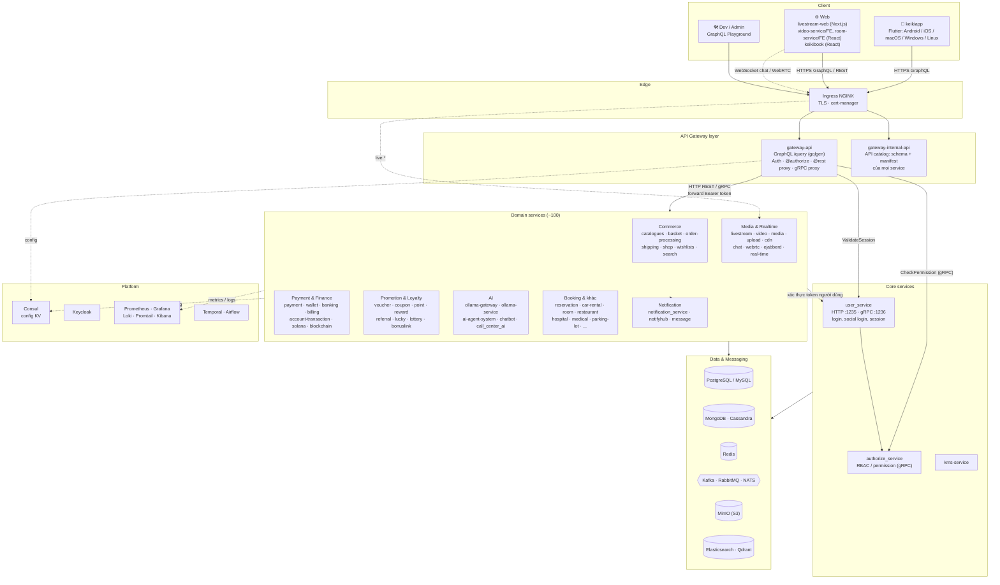
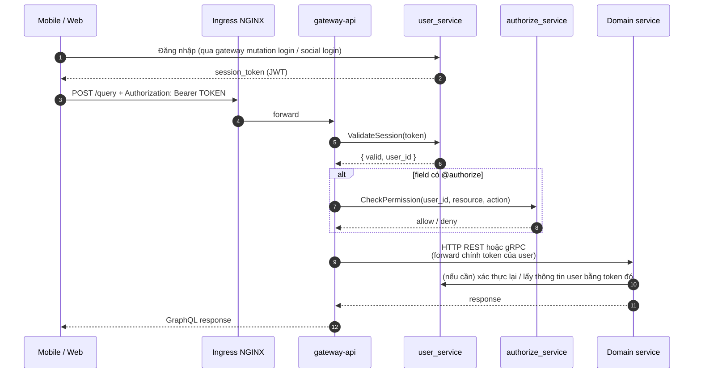
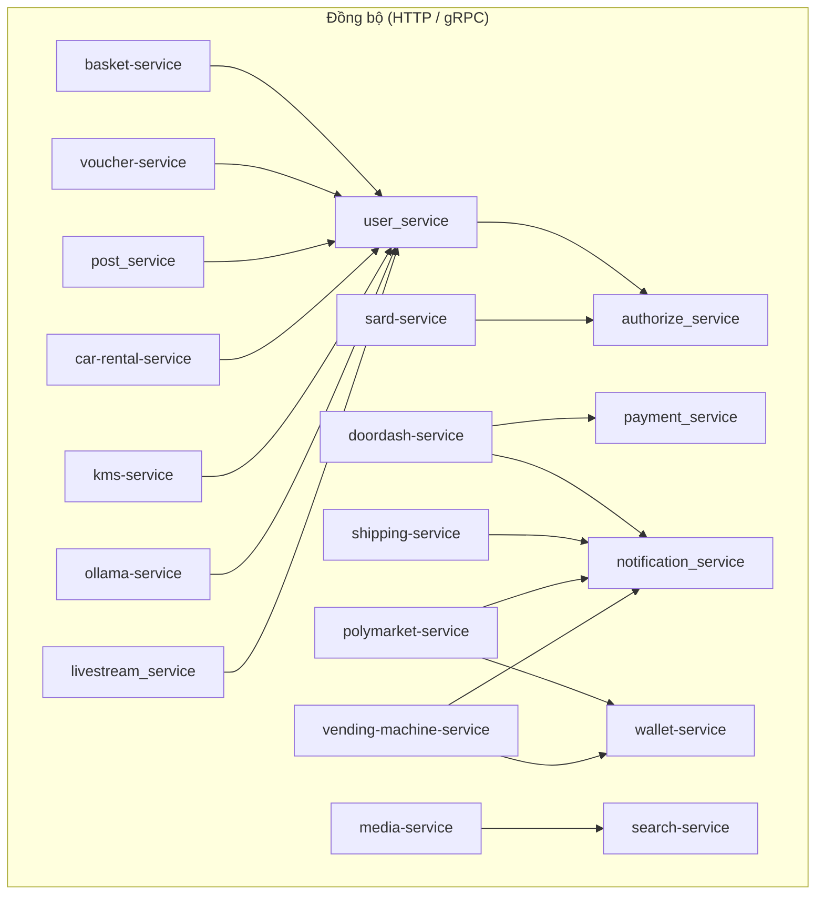
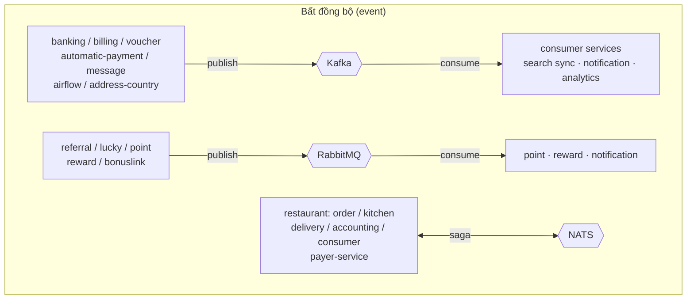
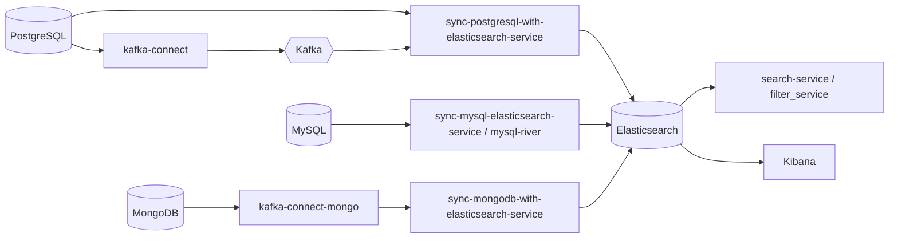
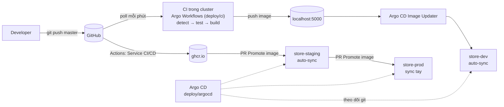

# store-service

Monorepo microservice cho nền tảng thương mại điện tử và các nghiệp vụ mở rộng (thanh toán, ví, khuyến mãi, livestream, AI, đặt chỗ, y tế, ...). Hơn 100 service, chủ yếu viết bằng **Go**, ngoài ra có Rust, Python, Node.js, Scala; frontend gồm app **Flutter** (mobile/desktop) và các web **React / Next.js**. Toàn bộ chạy trên **Kubernetes**, triển khai theo **GitOps** với Helm + Argo CD.

## Mục lục

- [Kiến trúc tổng thể](#kiến-trúc-tổng-thể)
- [Luồng request và xác thực](#luồng-request-và-xác-thực)
- [Giao tiếp giữa các service](#giao-tiếp-giữa-các-service)
- [Đồng bộ dữ liệu và tìm kiếm](#đồng-bộ-dữ-liệu-và-tìm-kiếm)
- [Danh sách service theo domain](#danh-sách-service-theo-domain)
- [Hạ tầng](#hạ-tầng)
- [Triển khai (CI/CD + GitOps)](#triển-khai-cicd--gitops)
- [Chạy local](#chạy-local)
- [Thêm service mới](#thêm-service-mới)
- [Tài liệu](#tài-liệu)

## Kiến trúc tổng thể



**Nguyên tắc chính**

- **Một cửa vào duy nhất**: mọi client (mobile, web) chỉ gọi `gateway-api` qua GraphQL tại `POST /query`. Các domain service không public ra ngoài (trừ một số luồng realtime như livestream WebSocket/WebRTC).
- **Gateway mỏng**: `gateway-api` không chứa nghiệp vụ. Mỗi field GraphQL map tới một endpoint REST (directive `@rest`, sinh code bằng `make generate`) hoặc một RPC gRPC của service phía sau.
- **Database per service**: mỗi service sở hữu database riêng, không service nào đọc trực tiếp DB của service khác.
- **Config tập trung**: service đọc `.env` để biết địa chỉ Consul, rồi tải cấu hình JSON (`consul.json`) từ Consul KV.
- **Zero-trust trong cluster**: NetworkPolicy default-deny, mỗi service khai báo rõ được gọi bởi ai và gọi tới ai.

## Luồng request và xác thực



- Gateway **luôn forward access token của người dùng** (`forward_user_token`), không dùng token service cố định. Service downstream gọi `user_service` bằng chính token đó.
- Một số service bên thứ ba / nội bộ đặc biệt dùng header riêng (`X-Api-Key`, `X-Api-Token`) cấu hình theo từng service trong `gateway-api/consul.json`.
- Field không yêu cầu đăng nhập vẫn đi qua gateway; `RequireAuthentication` kiểm tra theo từng root field.

## Giao tiếp giữa các service





| Kiểu | Công nghệ | Dùng khi |
|---|---|---|
| Đồng bộ | HTTP REST (Gin), gRPC | Cần kết quả ngay: xác thực, kiểm tra quyền, lấy dữ liệu |
| Event streaming | Kafka (+ Kafka Connect, Kafka UI) | Giao dịch tài chính, CDC, log sự kiện cần replay |
| Message queue | RabbitMQ | Tác vụ nền: cộng điểm, phát thưởng, referral, gửi thông báo |
| Saga / pub-sub nhẹ | NATS | Điều phối đơn hàng của nhóm `restaurant/*` |
| Workflow | Temporal, Airflow, goflow | Quy trình dài, job theo lịch |
| Realtime | WebSocket, WebRTC, XMPP (ejabberd) | Chat, livestream, gọi video |

## Đồng bộ dữ liệu và tìm kiếm



## Danh sách service theo domain

| Domain | Service |
|---|---|
| **Gateway** | `gateway-api`, `gateway-internal-api`, `ollama-gateway` |
| **Identity & Security** | `user_service`, `authorize_service`, `identified_service`, `ekyc-service`, `face-service`, `face-recognition-service`, `kms-service`, `sard-service` (auth / card / customer-info) |
| **Commerce** | `catalogues-service`, `basket-service`, `order-processing-service`, `shop-service` (Rust), `shopify-service`, `wishlists-service`, `shipping-service`, `address-country-service`, `geoservice`, `offer-range-service`, `partner-service`, `doordash-service`, `food-service`, `vending-machine-service` |
| **Payment & Finance** | `payment_service`, `payment-wallet-service`, `wallet-service`, `integrated-payment-service`, `automatic-payment-service`, `payer-service`, `banking-service`, `billing-service`, `account-transaction-service`, `calculate-service`, `subsidies-service`, `solana-service`, `blockchain-service`, `polymarket-service` |
| **Promotion & Loyalty** | `voucher-service`, `coupon-service`, `point-service`, `reward-service` (Rust), `recompense-service`, `bonuslink-service`, `referral-service`, `lucky-service`, `lottery-service`, `admanagement-service`, `shortlink-service`, `qr-service`, `share-service` |
| **Content & Media** | `media-service`, `photo-service`, `video-service`, `upload_service`, `cdn-service`, `draw-image-service`, `post_service`, `threads-service`, `book-service` (Scala), `book-store-service`, `movie-recommendation-service` |
| **Realtime & Communication** | `livestream_service`, `livestream-web`, `chat_service`, `webrtc-service`, `ejabberd-service`, `real-time-service`, `message-service`, `notification_service`, `notifyhub-service`, `networking-service` |
| **AI** | `ollama-service`, `ollama-model-py`, `ai-agent-system`, `chatbot-system`, `bot-service`, `call_center_ai`, `serpapi-service` |
| **Booking & Vertical** | `reservation-service`, `booking-mini-service` (Rust), `room-service`, `rent_house_service`, `car-rental-service`, `parking-lot-service`, `ticket-service`, `restaurant/*`, `hospital-patient-management-service`, `medical-service`, `recruitment-platform-service`, `customer-relationship-service` |
| **Search & Data** | `search-service`, `filter_service`, `sync-*-elasticsearch-service`, `airflow-service`, `goflow-service`, `workflow-service`, `worker_service`, `arrange-service` |
| **Ops & Tooling** | `toggle-service` (feature flag), `tool-service`, `manage_service`, `node-service` |
| **Frontend** | `keikiapp` (Flutter), `livestream-web` (Next.js), `video-service/FE`, `room-service/FE`, `keikibook` (React) |

Cấu trúc thư mục chuẩn của một Go service:

```
<service>/
├── cmd/            # entrypoint
├── internal/       # handler · usecase · repository · model
├── config/         # đọc .env + Consul
├── consul.json     # cấu hình mẫu đẩy lên Consul KV
├── Dockerfile
└── Makefile
```

## Hạ tầng

Toàn bộ hạ tầng có sẵn Helm chart trong [chart/](chart/):

| Nhóm | Thành phần |
|---|---|
| Database | PostgreSQL, MySQL, MongoDB, Cassandra, Redis |
| Messaging | Kafka, Zookeeper, Kafka Connect, Kafka UI, RabbitMQ, NATS |
| Search / Vector | Elasticsearch, Kibana, Qdrant |
| Storage | MinIO, ClamAV (quét file upload) |
| Identity / Config | Keycloak, Consul |
| Workflow | Temporal, Airflow |
| AI | Ollama |
| Observability | Prometheus, Grafana, Loki, Promtail |
| Network | NGINX, Ingress NGINX, cert-manager |

## Triển khai (CI/CD + GitOps)



- [chart/common](chart/common): library chart chuẩn production (RollingUpdate `maxUnavailable: 0`, probe, HPA, PDB, NetworkPolicy, ExternalSecret, chạy non-root).
- [chart/platform](chart/platform): Namespace, ResourceQuota, LimitRange, NetworkPolicy nền cho từng môi trường.
- `chart/<svc>/values-{dev,staging,prod}.yaml`: overlay theo môi trường.
- Chi tiết đầy đủ: [deploy/README.md](deploy/README.md).

## Chạy local

Yêu cầu: Docker Desktop (bật Kubernetes), `kubectl`, `helm`, Go 1.23+.

```sh
# 1. Hạ tầng dùng chung (Consul, Postgres, MySQL, Kafka, ...) trong namespace default
helm template chart-1785009827 ./chart -n default -f chart/values-infra-only.yaml | kubectl apply -n default -f -

# 2. Argo CD + ingress + External Secrets + store-dev
deploy/bootstrap-local.sh install
deploy/bootstrap-local.sh status

# 3. Build và deploy tay một service qua CI trong cluster
deploy/bootstrap-local.sh ci-run <service>   # hoặc: all
```

Chạy riêng một service khi phát triển:

```sh
cd <service>
cp .env.example .env        # nếu có; .env chứa địa chỉ Consul local
make run                    # hoặc: go run .
```

| URL local | Mô tả |
|---|---|
| `http://argocd.store.local:8081` | Argo CD |
| `http://workflows.store.local:8081` | Argo Workflows (CI) |
| `http://localhost:8080/` | GraphQL Playground của `gateway-api` |
| `http://localhost:1235/swagger/index.html` | Swagger `user_service` |

## Thêm service mới

1. Tạo service theo cấu trúc chuẩn, cấu hình đọc từ Consul.
2. Tạo chart `chart/<svc>` dùng `chart/common`, thêm `values-dev.yaml`.
3. Đăng ký vào CI: thêm mục trong `deploy/ci/services.yaml`, chạy `python3 deploy/ci/scripts/gen-image-updater.py`.
4. Mở API ra ngoài qua gateway: thêm địa chỉ service vào `gateway-api/consul.json`, viết schema `gateway-api/graph/<svc>.graphqls` với directive `@rest`, chạy `make generate` trong `gateway-api`.
5. Khai báo NetworkPolicy (`allowFromApps` cho `gateway-api`, `allowToApps` cho các service nó gọi).

## Tài liệu

- Trello: https://trello.com/invite/b/Xr2VZyyz/ATTI3cb68d7010beef35d8ead8a2e31c3789B4ACCBC1/store-service
- Notion: https://www.notion.so/Getting-Started-1621c27a3dd580dc806dce41bcaaf8eb?pvs=4
- Low level design: https://ak67373.medium.com/low-level-design-inquestion-26f99bc504c6
- Bảo mật: [SECURITY.md](SECURITY.md)
